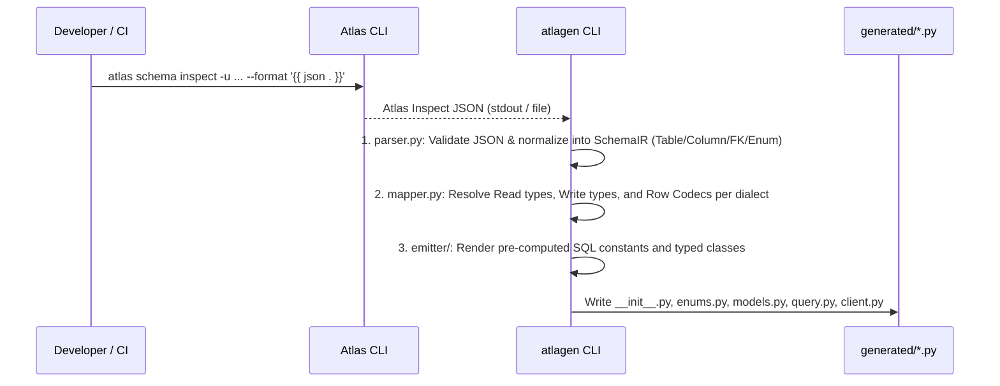
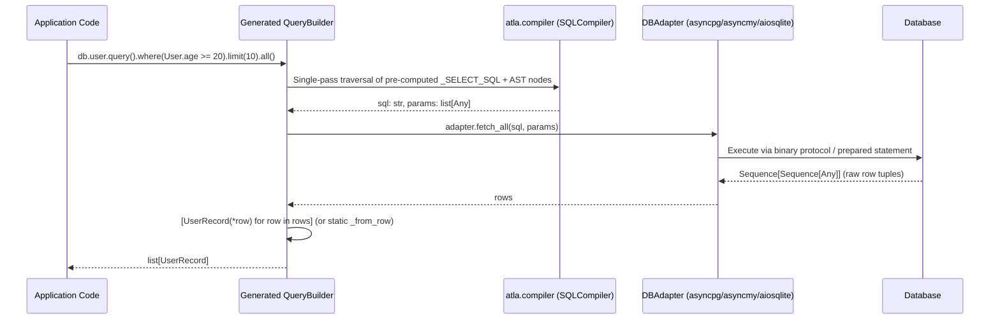

# System Architecture & Design Principles

This document defines the overall architecture, core design principles, and key engineering refinements of `atla` (the zero-dependency runtime core) and `atlagen` (the Ahead-of-Time code generator).

---

## 1. Four Core Design Pillars

### 1.1 Single Source of Truth: Full Delegation to Atlas
- Traditional Python ORMs (SQLAlchemy + Alembic, Django ORM, Tortoise ORM, etc.) define database schemas using Python classes and attempt to infer DDL migrations from them. In practice, expressing composite/partial indexes, database-specific types, triggers, check constraints, and NewSQL extensions (CockroachDB / TiDB) in Python classes is leaky and error-prone.
- `atla` and `atlagen` treat **Atlas (`schema.hcl` or `.sql`) as the single source of truth**. Schema inspection, migration planning, linting, and deployment are handled exclusively by the Atlas CLI, while `atlagen` consumes the normalized JSON schema emitted by `atlas schema inspect` to generate type-safe Python code.

### 1.2 Zero Runtime Overhead: Extreme Performance via AOT Code Generation
- In Python database applications, CPU bottlenecks rarely come from the wire protocol itself—they come from **ORM row object instantiation** and **runtime metadata inspection / SQL string construction**.
- ORMs built on SQLAlchemy or Pydantic perform per-row type validation, intermediate dictionary allocation, and attribute proxy tracking, incurring a 5x–20x CPU overhead compared to raw C-extension drivers like `asyncpg`.
- `atla` and `atlagen` eliminate runtime overhead through four mechanisms:
  1. **Zero Third-Party Runtime Dependencies (`atla`)**: Built exclusively on the Python 3.12+ standard library.
  2. **Direct Tuple Unpacking into `@dataclass(slots=True, frozen=True)`**: Row tuples/records returned by DB drivers are bound directly via `[UserRecord(*row) for row in rows]` (or a dialect-specialized static `_from_row` function), eliminating intermediate `dict` allocations entirely.
  3. **AOT Pre-computed Static SQL Fragments**: Table-specific static SQL clauses such as `SELECT "users"."id", "users"."email", ... FROM "users"` are pre-computed at code generation time by `atlagen` and emitted as class constants (`_SELECT_SQL`), avoiding runtime string joins for column projections.
  4. **`__slots__` Across Every AST Node and Query Builder**: Minimizes small-object allocation overhead and garbage collection pressure when constructing dynamic queries.

### 1.3 Compile-time Type Safety: First-Class Pyright & Mypy Strict Mode Support
- Instead of string-based column references (`.filter("age >=", 20)`) or untyped `**kwargs` filters (`.filter(age__gte=20)`), `atla` uses Drizzle/Ent-style typed expression trees (`Column[T]` -> `Expr[bool]`).
- Full IDE autocompletion works across table names, column names, operators, and return types. When a database schema changes, running `atlagen generate` followed by `pyright` or `mypy` immediately surfaces every affected query at compile/CI time.

### 1.4 Multi-RDBMS & NewSQL Native Support
- A single unified abstraction layer natively supports five database engines:
  - **PostgreSQL** (`asyncpg` / `psycopg`)
  - **CockroachDB** (`asyncpg` / PostgreSQL-compatible wire protocol + Cockroach-specific types)
  - **MySQL** (`asyncmy`)
  - **TiDB** (`asyncmy` / MySQL-compatible wire protocol + `AUTO_RANDOM`, etc.)
  - **SQLite** (`aiosqlite` / local development, edge, and embedded workloads)

---

## 2. Key Architectural Refinements Over the Initial Proposal

While preserving the simplicity of the initial proposal, the architecture incorporates several critical refinements to solve real-world Python typing and SQL generation edge cases:

| Area | Limitation in Initial Draft | Refined Design (`atla` / `atlagen`) |
| :--- | :--- | :--- |
| **Expression Type System** | Typing `where(*clauses: BinaryOp)` prevents passing `and_()` / `or_()` (`LogicalOp`), `in_()` (`InOp`), or `is_null()` (`UnaryOp`) | Introduce a generic base class **`Expr[T]`** representing an SQL expression evaluating to Python type `T`. Predicates inherit from **`Expr[bool]`**, allowing `where(*predicates: Expr[bool])` to accept any valid boolean SQL expression uniformly. |
| **`==` & `bool()` Pitfalls** | Python's `object.__eq__` signature constraints and accidental short-circuiting when a user writes `User.age > 20 and User.is_active` (where Python's `and` silently drops a clause) | Override `Expr.__bool__` to immediately raise a descriptive `TypeError`, preventing accidental use of Python's `and`/`or`/`not`. Provide both operator overloads (`==`, `!=`, `&`, `\|`, `~`) and linter-friendly explicit methods (`.eq()`, `.ne()`, `.is_null()`, `.is_not_null()`) that never trigger Ruff `E711`/`E712`. |
| **Self-Joins & Table Aliasing** | A single `User` singleton cannot disambiguate columns when joining the same table twice | `User.as_("manager")` instantiates a lightweight aliased `UserTable(alias="manager")` whose columns resolve to `"manager"."id"`. |
| **SQLite / MySQL Row Decoding** | While `asyncpg` natively returns `UUID` and `datetime`, `aiosqlite` and `asyncmy` tuple cursors may return strings or integers (`0`/`1`) | Instead of runtime reflection, **`atlagen` emits an optimal static `_from_row` function at codegen time** tailored to the target dialect and column types (using direct `Record(*row)` when no conversion is needed). |
| **Type-Safe `INSERT` & `UPDATE`** | Using a single `Record` class for inserts forces callers to pass `AUTO_INCREMENT` or `DEFAULT CURRENT_TIMESTAMP` columns | `atlagen` inspects `default`, `auto_increment`, `identity`, and `null` attributes in the Atlas JSON to generate **`insert()` signatures that distinguish required keyword arguments from optional (`= UNSET`) arguments**. |
| **Query Builder Immutability** | Mutable query builders corrupt shared state when a base query is stored in a variable and branched | Every query builder method (`where`, `limit`, `order_by`, etc.) returns a new lightweight `__slots__` instance via shallow tuple copying (**Immutable Fluent Builder**). |
| **Transaction Management** | `DBAdapter` only defined `fetch_all` / `fetch_one` / `execute`, which cannot pin a connection from a pool across a transaction | Define `DBAdapter.transaction()` and `AtlaClient.transaction()` async context managers that yield a client bound to a single pinned connection and active transaction (with nested `SAVEPOINT` support). |

---

## 3. Repository & Monorepo Layout

The project uses a `uv` workspace monorepo layout, cleanly separating the zero-dependency runtime (`atla`) from the CLI code generator (`atlagen`).

```text
atla/
├── pyproject.toml                 # uv workspace root / ruff / pyright / pytest configuration
├── README.md
├── docs/                          # Design specifications & roadmap
│   ├── architecture.md
│   ├── runtime-spec.md
│   ├── generator-spec.md
│   └── roadmap.md
├── packages/
│   ├── atla/                      # [Runtime Core] Zero external dependencies
│   │   ├── pyproject.toml         # optional-dependencies: pg, mysql, sqlite
│   │   └── src/
│   │       └── atla/
│   │           ├── __init__.py    # Public API (Expr, Column, and_, or_, not_, raw_sql, etc.)
│   │           ├── py.typed       # PEP 561 marker
│   │           ├── types.py       # Common type aliases & sentinel types (UNSET, UnsetType)
│   │           ├── errors.py      # Exception hierarchy (AtlaError, NotFoundError, UnsafeMutationError, etc.)
│   │           ├── expressions.py # Expression Tree AST (Expr[T], Column[T], BinaryOp, LogicalOp, OrderBy, etc.)
│   │           ├── dialect.py     # Dialect base class & Postgres / Cockroach / MySQL / TiDB / SQLite dialects
│   │           ├── compiler.py    # Single-pass SQL + bind parameter compiler
│   │           ├── query.py       # Generic immutable BaseQuery / Mutation runtime classes
│   │           └── adapter/       # Database driver adapters
│   │               ├── __init__.py
│   │               ├── base.py        # DBAdapter Protocol
│   │               ├── asyncpg.py     # PostgreSQL / CockroachDB (asyncpg)
│   │               ├── asyncmy.py     # MySQL / TiDB (asyncmy)
│   │               └── aiosqlite.py   # SQLite (aiosqlite)
│   │
│   └── atlagen/                   # [CLI Code Generator] Development-time tool
│       ├── pyproject.toml         # [project.scripts] atlagen = "atlagen.cli:main"
│       └── src/
│           └── atlagen/
│               ├── __init__.py
│               ├── py.typed
│               ├── cli.py         # CLI entry point & argument parser
│               ├── config.py      # pyproject.toml ([tool.atlagen]) & CLI option resolution
│               ├── inspect.py     # Atlas JSON loader (file / stdin / atlas CLI subprocess)
│               ├── ir.py          # Normalized Internal Representation (SchemaIR, TableIR, ColumnIR, etc.)
│               ├── parser.py      # Atlas JSON -> SchemaIR parser
│               ├── mapper.py      # Dialect-specific SQL type -> Python type & row codec mapper
│               └── emitter/       # Deterministic Python code emitters
│                   ├── __init__.py
│                   ├── enums.py       # Emits enums.py
│                   ├── models.py      # Emits models.py
│                   ├── query.py       # Emits query.py
│                   └── client.py      # Emits client.py & __init__.py
└── tests/                         # Test suite
    ├── unit/                      # Unit tests for AST, compiler, parser, and mapper
    ├── typecheck/                 # Pyright / Mypy positive & negative static type tests
    ├── integration/               # End-to-end integration tests across PG, MySQL, and SQLite
    └── benchmarks/                # Performance benchmarks vs. raw drivers & SQLAlchemy 2.0
```

---

## 4. Data Flow & Execution Pipeline

### 4.1 Code Generation Phase (Build / Development Time)



### 4.2 Query Execution Phase (Application Runtime)



---

## 5. Performance Targets & Quality Standards

1. **Runtime Overhead Target**:
   - CPU time for hydrating 1,000 rows into `list[UserRecord]` must stay within **+15% of raw driver execution (`asyncpg.fetch()`)**, and at least **5x faster than SQLAlchemy 2.0 ORM**.
2. **Static Type Checking Standard**:
   - `atla`, `atlagen`, and all code generated by `atlagen` must pass both `pyright --strict` and `mypy --strict` with zero errors or warnings.
   - Invalid type comparisons (e.g., `User.age == "20"`), non-existent column access, and `insert()` calls missing required columns must be reliably rejected by static type checkers (verified via negative type-checking tests).
3. **Zero Runtime Dependencies**:
   - The `atla` package must maintain `dependencies = []` in `pyproject.toml`, allowing users to install only the database driver(s) required for their deployment.
