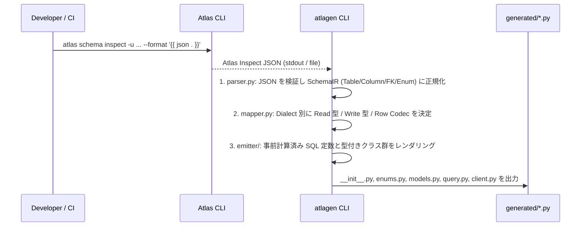
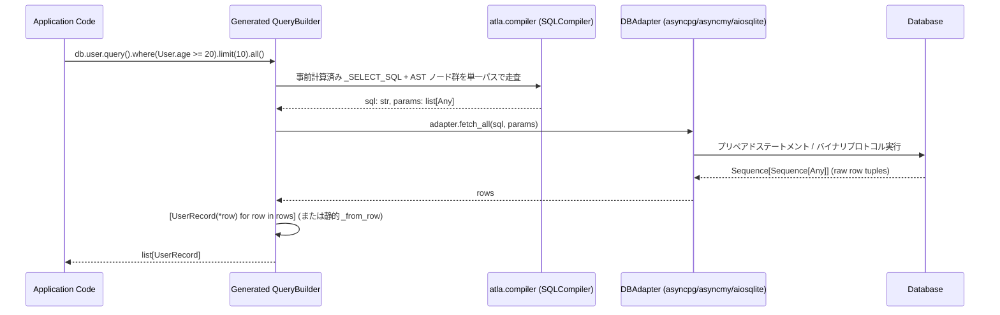

# システムアーキテクチャ & 設計原則 (Architecture & Design Principles)

本ドキュメントでは、`atla`（ランタイムコア）および `atlagen`（AOT コードジェネレータ）の全体アーキテクチャ、設計思想、および初期企画案からブラッシュアップされた技術的判断について定義します。

---

## 1. 4つのコア設計思想 (Core Pillars)

### 1.1 Single Source of Truth: Atlas への完全委譲
- Python の従来の ORM（SQLAlchemy + Alembic、Django ORM、Tortoise ORM 等）は、「Python クラスでスキーマを定義し、そこから DDL を推論・生成する」アプローチを採っています。しかし、複合インデックス、部分インデックス、データベース固有型、トリガー、Check 制約、NewSQL 固有構文（CockroachDB / TiDB）などを Python コードで正確に表現するのは限界があります。
- `atla` / `atlagen` は **Atlas (`schema.hcl` または `.sql`) を唯一のスキーマ定義源** とします。マイグレーション計画・Lint・適用はすべて Atlas CLI が担い、`atlagen` は Atlas が解析した正規化済み JSON スキーマを入力として Python コードを生成します。

### 1.2 Zero Runtime Overhead: AOT（事前生成）による極限の高速化
- Python における DB アクセスのボトルネックは、ネットワーク I/O だけでなく **「ORM による行オブジェクトの構築コスト」** と **「実行時のメタデータ検査・SQL 文字列構築コスト」** にあります。
- SQLAlchemy や Pydantic ベースの ORM は、1行ごとに型バリデーション・辞書生成・属性プロキシ生成を行うため、`asyncpg` などの C 拡張ドライバ単体と比較して 5〜20 倍の CPU オーバーヘッドが発生します。
- `atla` / `atlagen` は以下のアプローチでランタイムオーバーヘッドを限りなくゼロにします：
  1. **ランタイム外部依存ゼロ (`atla`)**: 標準ライブラリのみで構成。
  2. **`@dataclass(slots=True, frozen=True)` への直接タプルアンパック**: DB ドライバから返却されるタプル/Record を `[UserRecord(*row) for row in rows]`（または Dialect 特化の静的 `_from_row` 関数）で直接バインドし、中間 `dict` の生成を完全に排除。
  3. **静的 SQL フラグメントの事前計算 (AOT Pre-computation)**: `SELECT "users"."id", "users"."email", ... FROM "users"` のようなテーブル固有の固定 SQL 文字列は、実行時に結合するのではなく、`atlagen` がコード生成時にクラス定数 (`_SELECT_SQL`) として出力。
  4. **全 AST ノード・クエリビルダへの `__slots__` 適用**: 動的クエリ組み立て時の小オブジェクト割り当てコストと GC 負荷を最小化。

### 1.3 Compile-time Type Safety: Pyright / Mypy Strict Mode 完全対応
- 文字列によるカラム指定 (`.filter("age >=", 20)`) や、型情報が失われる `**kwargs` フィルタ (`.filter(age__gte=20)`) を廃止し、Drizzle / Ent スタイルの型付き式木 (`Column[T]` -> `Expr[bool]`) を採用します。
- IDE（VSCode / PyCharm / Neovim）上でテーブル名・カラム名・演算子・戻り値型のすべてで補完が効き、スキーマ変更時には `atlagen generate` 後に `pyright` / `mypy` を実行するだけで、影響を受けるすべてのクエリ箇所をコンパイル時（CI 時）に検出できます。

### 1.4 Multi-RDBMS & NewSQL ネイティブ対応
- 単一の抽象化レイヤーで以下の 5 つのデータベースエンジンをサポートします：
  - **PostgreSQL** (`asyncpg` / `psycopg`)
  - **CockroachDB** (`asyncpg` / PostgreSQL 互換 + 固有型対応)
  - **MySQL** (`asyncmy`)
  - **TiDB** (`asyncmy` / MySQL 互換 + Auto Random 等対応)
  - **SQLite** (`aiosqlite` / ローカル開発・エッジ・組み込み用途)

---

## 2. 初期企画からの主要な設計改善点 (Refinements & Improvements)

初期企画のシンプルさを維持しつつ、実用時・大規模開発時に直面する Python 型システムおよび SQL 生成の課題を解決するため、以下の設計改善を取り入れています。

| 領域 | 初期企画の課題 | 改善後の設計 (`atla` / `atlagen`) |
| :--- | :--- | :--- |
| **式の型システム** | `where(*clauses: BinaryOp)` だと、`and_()` / `or_()` (`LogicalOp`) や `in_()` (`InOp`)、`is_null()` (`UnaryOp`) を渡せない | すべての式木の基底としてジェネリクス **`Expr[T]`** を導入。条件式はすべて **`Expr[bool]`** を継承し、`where(*predicates: Expr[bool])` で統一的に型検査する |
| **`==` / `bool()` の罠** | Python の `object.__eq__` シグネチャ制約や、誤って `User.age > 20 and User.is_active` と書いた際に Python の `and` が短絡評価されて条件が消えるバグ | `Expr.__bool__` で即座に `TypeError` を送出して `and`/`or` 誤用を防止。また演算子 (`==`, `!=`, `&`, `\|`, `~`) に加え、Linter (Ruff E711/E712) と競合しない明示メソッド (`.eq()`, `.ne()`, `.is_null()`, `.is_not_null()`) を併設 |
| **テーブル自己結合 (Self-Join)** | `User` シングルトンのみだと、同一テーブルを2回 JOIN するクエリでカラム名の衝突が起きる | `User.as_("manager")` により軽量なエイリアス付きテーブルインスタンスを生成可能にし、`"manager"."id"` のように解決する |
| **SQLite / MySQL の型デコード** | `asyncpg` は自動で `UUID` や `datetime` を返すが、`aiosqlite` や `asyncmy` のタプルカーソルは文字列や整数 (`0`/`1`) を返す場合がある | 実行時にリフレクションするのではなく、**`atlagen` が Dialect とカラム型に応じて最適な静的 `_from_row` 関数をコード生成時に出力**する（PG で変換不要な場合は直接 `Record(*row)` を呼ぶ） |
| **INSERT / UPDATE の型安全性** | 全カラム必須の Record クラスしかなかった場合、`AUTO_INCREMENT` や `DEFAULT CURRENT_TIMESTAMP` のカラムまで INSERT 時に指定を強制される | Atlas JSON の `default` / `auto_increment` / `null` 属性を解析し、**必須引数と省略可能 (`NotRequired` / デフォルト付きキーワード引数) を区別した `insert()` シグネチャ**を生成する |
| **クエリビルダの不変性 (Immutability)** | ミュータブルな QueryBuilder は、ベースクエリを変数に保持して分岐させた際に状態が汚染される | QueryBuilder の各メソッド (`where`, `limit`, `order_by` 等) は内部タプルをシャローコピーした新しい軽量インスタンス (`__slots__`) を返す **Immutable Fluent Builder** とする |
| **トランザクション管理** | `DBAdapter` に `fetch_all` / `fetch_one` / `execute` しかなかったため、コネクションプール環境でトランザクションを張れない | `DBAdapter.transaction()` および `AtlaClient.transaction()` コンテキストマネージャを定義し、トランザクション中は同一コネクションにピン留めされたクライアントを提供する |

---

## 3. リポジトリ・パッケージ構成 (Monorepo Layout)

本プロジェクトは `uv` ワークスペースを用いたモノレポ構成を採用し、ランタイム (`atla`) とコードジェネレータ (`atlagen`) を明確に分離します。

```text
atla/
├── pyproject.toml                 # uv workspace ルート設定 / ruff / pyright / pytest 設定
├── README.md
├── docs/                          # 設計仕様書・ロードマップ
│   ├── architecture.md
│   ├── runtime-spec.md
│   ├── generator-spec.md
│   └── roadmap.md
├── packages/
│   ├── atla/                      # [Runtime Core] 外部依存ゼロ (Zero Dependencies)
│   │   ├── pyproject.toml         # optional-dependencies: pg, mysql, sqlite
│   │   └── src/
│   │       └── atla/
│   │           ├── __init__.py    # 公開 API (Expr, Column, and_, or_, not_, sql, etc.)
│   │           ├── py.typed       # PEP 561 マーカー
│   │           ├── types.py       # 共通型エイリアス・マーカー型 (UNSET 等)
│   │           ├── errors.py      # 例外階層 (AtlaError, NotFoundError, MultipleResultsError 等)
│   │           ├── expressions.py # 式木 AST (Expr[T], Column[T], BinaryOp, LogicalOp, OrderBy 等)
│   │           ├── dialect.py     # Dialect 基底と Postgres / MySQL / SQLite 実装
│   │           ├── compiler.py    # 単一パス SQL + パラメータコンパイラ
│   │           ├── query.py       # ジェネリック BaseQuery / Mutation ランタイムヘルパー
│   │           └── adapter/       # DB ドライバアダプタ実装
│   │               ├── __init__.py
│   │               ├── base.py        # DBAdapter / TransactionAdapter Protocol
│   │               ├── asyncpg.py     # PostgreSQL / CockroachDB (asyncpg)
│   │               ├── asyncmy.py     # MySQL / TiDB (asyncmy)
│   │               └── aiosqlite.py   # SQLite (aiosqlite)
│   │
│   └── atlagen/                   # [CLI Code Generator] 開発時ツール
│       ├── pyproject.toml         # [project.scripts] atlagen = "atlagen.cli:main"
│       └── src/
│           └── atlagen/
│               ├── __init__.py
│               ├── py.typed
│               ├── cli.py         # CLI エントリポイント & 引数解析
│               ├── config.py      # pyproject.toml ([tool.atlagen]) & CLI オプション統合
│               ├── inspect.py     # Atlas JSON 読み込み (ファイル / stdin / atlas CLI 実行)
│               ├── ir.py          # 正規化済み内部表現 (SchemaIR, TableIR, ColumnIR 等)
│               ├── parser.py      # Atlas JSON -> SchemaIR パーサ
│               ├── mapper.py      # Dialect 別 SQL 型 -> Python 型 & 変換戦略マッパー
│               └── emitter/       # Python コード生成器
│                   ├── __init__.py
│                   ├── enums.py       # enums.py 生成
│                   ├── models.py      # models.py 生成
│                   ├── query.py       # query.py 生成
│                   └── client.py      # client.py & __init__.py 生成
└── tests/                         # テストスイート
    ├── unit/                      # 式木・SQL コンパイラ・パーサ・マッパー単体テスト
    ├── typecheck/                 # Pyright / Mypy による生成コードの型安全性検証テスト
    ├── integration/               # 各 DB (PG / MySQL / SQLite) に対する結合テスト
    └── benchmarks/                # raw ドライバ / SQLAlchemy との速度比較ベンチマーク
```

---

## 4. データフローと実行パイプライン (Data Flow Pipeline)

### 4.1 コード生成フェーズ (Compile / Build Time)



### 4.2 クエリ実行フェーズ (Application Runtime)



---

## 5. パフォーマンス目標と品質基準 (Performance & Quality Targets)

1. **オーバーヘッド目標**:
   - 1,000 行フェッチ時のモデル生成 (`list[UserRecord]` 変換) における CPU 時間を、素のドライバ (`asyncpg.fetch()`) 対比で **+15% 以内**（SQLAlchemy 2.0 ORM 対比で **5倍以上高速**）に抑える。
2. **静的型チェック基準**:
   - `atla` 本体、`atlagen` 本体、および `atlagen` が生成するすべてのコードが `pyright --strict` および `mypy --strict` を警告・エラーゼロで通過すること。
   - 不正な型の比較（例: `User.age == "20"`）や存在しないカラム参照、必須カラムが欠落した `insert()` が型チェッカーによって確実にエラーとして検出されること（ネガティブ型テストで検証）。
3. **ゼロランタイム依存**:
   - `atla` パッケージの `dependencies` は空 (`[]`) とし、使用する DB ドライバのみをユーザーが選択してインストールできる構成とする。
