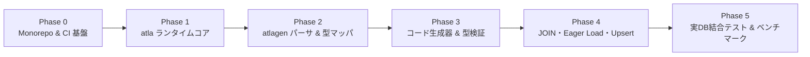

# 実装ロードマップ & タスク計画 (Implementation Roadmap)

本ドキュメントでは、`atla` および `atlagen` の開発フェーズ分割、各マイルストーンの到達目標、および GitHub Issues で管理するタスク一覧を定義します。

---

## フェーズ全体像 (Milestone Overview)

---

## GitHub Issues 一覧 (Tracking Issues)

| Issue | フェーズ | タイトル |
| :--- | :--- | :--- |
| [#1](https://github.com/hirokazumiyaji/atla/issues/1) | Phase 0 | モノレポ構成 (`uv` workspace) と開発ツールチェーン・CI 基盤の構築 |
| [#2](https://github.com/hirokazumiyaji/atla/issues/2) | Phase 1 | `atla`: 式木 (Expression Tree) AST (`Expr[T]`, `Column[T]`, 演算子・集約関数) の実装 |
| [#3](https://github.com/hirokazumiyaji/atla/issues/3) | Phase 1 | `atla`: Dialect 抽象化と単一パス `SQLCompiler` の実装 |
| [#4](https://github.com/hirokazumiyaji/atla/issues/4) | Phase 1 | `atla`: `DBAdapter` プロトコル・トランザクション管理・各ドライバアダプタ (`asyncpg` / `asyncmy` / `aiosqlite`) の実装 |
| [#5](https://github.com/hirokazumiyaji/atla/issues/5) | Phase 1 | `atla`: イミュータブル `BaseQuery` / `Mutation` ランタイムクラスの実装 |
| [#6](https://github.com/hirokazumiyaji/atla/issues/6) | Phase 2 | `atlagen`: Atlas JSON スキーマパーサと内部中間表現 (`SchemaIR`) の実装 |
| [#7](https://github.com/hirokazumiyaji/atla/issues/7) | Phase 2 | `atlagen`: RDBMS 別 SQL 型 -> Python 型マッパーと Row Codec 解決器の実装 |
| [#8](https://github.com/hirokazumiyaji/atla/issues/8) | Phase 2 | `atlagen`: CLI インターフェース (`generate` / `check`) と設定ローダの実装 |
| [#9](https://github.com/hirokazumiyaji/atla/issues/9) | Phase 3 | `atlagen`: コードエミッタ (`enums.py`, `models.py`, `query.py`, `client.py`) の実装 |
| [#10](https://github.com/hirokazumiyaji/atla/issues/10) | Phase 3 | 生成コードに対する静的型検証テストスイート (Pyright / Mypy strict mode) の構築 |
| [#11](https://github.com/hirokazumiyaji/atla/issues/11) | Phase 4 | 型安全な JOIN (`inner` / `left join` / 自己結合エイリアス) と Batch Eager Loading の実装 |
| [#12](https://github.com/hirokazumiyaji/atla/issues/12) | Phase 4 & 5 | Bulk Insert / Upsert / 部分選択の実装とマルチ RDBMS 結合テスト・ベンチマーク構築 |

---

## Phase 0: プロジェクト基盤 & モノレポ構築 (Project Scaffolding)

`atla`（依存ゼロランタイム）と `atlagen`（コード生成 CLI）を同一リポジトリで開発・テストするための `uv` ワークスペース基盤と品質ゲートを構築します。

### タスク:
- **[#1](https://github.com/hirokazumiyaji/atla/issues/1) モノレポ構成と開発ツールチェーンのセットアップ**
  - `packages/atla` および `packages/atlagen` の `pyproject.toml` 作成 (`uv` workspace)
  - `ruff` (lint/format), `pyright --strict`, `mypy --strict`, `pytest`, `pytest-asyncio` の設定
  - GitHub Actions CI ワークフロー（Lint / Typecheck / Unit Test）の構成

---

## Phase 1: `atla` ランタイムコア実装 (Runtime Core Foundation)

外部依存ゼロ・全クラス `__slots__` ベースの超軽量ランタイムを実装します。

### タスク:
- **[#2](https://github.com/hirokazumiyaji/atla/issues/2) 式木 (Expression Tree) AST の実装 (`atla/expressions.py`)**
  - `Expr[T_co]`, `Column[T]`, `Literal[T]`, `BinaryOp[T]`, `UnaryOp[T]`, `LogicalOp`, `InOp[T]`, `BetweenOp[T]`, `FuncCall[T]`, `RawSQL[T]`, `OrderByClause` の実装
  - `Expr.__bool__` による誤用防止ガード、空 `IN ()` の安全なフォールバック (`1 = 0` / `1 = 1`)
  - 論理ヘルパー (`and_`, `or_`, `not_`) および集約関数 (`count`, `sum_`, `avg`, `min_`, `max_`) の実装
- **[#3](https://github.com/hirokazumiyaji/atla/issues/3) Dialect と単一パス SQL コンパイラの実装 (`atla/dialect.py`, `atla/compiler.py`)**
  - `PostgresDialect`, `CockroachDialect`, `MySQLDialect`, `TiDBDialect`, `SQLiteDialect` の実装
  - 識別子クォート、プレースホルダ採番 (`$n`, `%s`, `?`)、`ILIKE` の方言別展開ロジック
  - `SQLCompiler` による中間文字列生成を抑えた単一パス AST コンパイル
- **[#4](https://github.com/hirokazumiyaji/atla/issues/4) `DBAdapter` プロトコルと各 DB ドライバアダプタの実装 (`atla/adapter/`)**
  - `DBAdapter` プロトコル定義 (`fetch_all`, `fetch_one`, `fetch_val`, `execute`, `execute_many`, `transaction`)
  - `AsyncpgAdapter` (PostgreSQL / CockroachDB)、`AsyncmyAdapter` (MySQL / TiDB)、`AiosqliteAdapter` (SQLite) の実装
  - ネスト対応（SAVEPOINT）の非同期トランザクションコンテキストマネージャ実装
- **[#5](https://github.com/hirokazumiyaji/atla/issues/5) イミュータブル BaseQuery / Mutation ランタイムクラスの実装 (`atla/query.py`, `atla/errors.py`)**
  - `BaseSelectQuery[RecordT]` (`where`, `order_by`, `limit`, `offset`, `all`, `first`, `one`, `count`, `exists`, `to_sql`)
  - `BaseInsertQuery[RecordT]`, `BaseUpdateQuery[RecordT]`, `BaseDeleteQuery` の実装
  - `UnsafeMutationError`（WHERE 句なし UPDATE/DELETE 防止ガード）、`NotFoundError`、`MultipleResultsError` の実装

---

## Phase 2: `atlagen` CLI & スキーマ解析基盤 (CLI & Schema Parsing)

Atlas CLI が出力する JSON スキーマを読み取り、RDBMS ごとの差異を吸収した内部表現 (`SchemaIR`) と型マッピングを構築します。

### タスク:
- **[#6](https://github.com/hirokazumiyaji/atla/issues/6) Atlas JSON スキーマパーサと内部 IR (`SchemaIR`) の実装 (`atlagen/ir.py`, `atlagen/parser.py`)**
  - Atlas `schema inspect` JSON 構造 (`schemas`, `tables`, `columns`, `primary_key`, `foreign_keys`, `indexes`, `enums`) のデシリアライズと検証
  - テーブル名・カラム名から Python 識別子（PascalCase モデル名、snake_case 属性名、Python 予約語回避）への正規化
  - `default` 属性や `auto_increment` / `identity` の検出による必須・任意カラム判定
- **[#7](https://github.com/hirokazumiyaji/atla/issues/7) RDBMS 別 SQL 型 -> Python 型マッパーと Row Codec 解決器の実装 (`atlagen/mapper.py`)**
  - PostgreSQL / CockroachDB / MySQL / TiDB / SQLite の全標準 SQL 型（サイズ指定・unsigned・配列・Enum・UUID・JSON 含む）の型マッピング
  - `null: true` に基づく `T | None` ラッピングと必要 import シンボルの収集
  - SQLite / MySQL 等でタプルから Python 型への軽量デコードが必要なカラム向けの静的 `_from_row` 変換式生成
- **[#8](https://github.com/hirokazumiyaji/atla/issues/8) `atlagen` CLI インターフェースと設定ローダの実装 (`atlagen/cli.py`, `atlagen/config.py`, `atlagen/inspect.py`)**
  - `atlagen generate` および CI 用 `atlagen check` サブコマンドの実装
  - 標準入力パイプ (`-`)、JSON ファイルパス、および `atlas schema inspect` サブプロセス呼び出しの3入力モード対応
  - `pyproject.toml` の `[tool.atlagen]` セクション読み取り対応

---

## Phase 3: コードエミッタ実装 & 静的型検証 (Code Emission & Type Verification)

`SchemaIR` から実際に Python コード群 (`enums.py`, `models.py`, `query.py`, `client.py`, `__init__.py`) を出力し、Pyright / Mypy で厳密に検証します。

### タスク:
- **[#9](https://github.com/hirokazumiyaji/atla/issues/9) コードエミッタ (`enums.py`, `models.py`, `query.py`, `client.py`) の実装 (`atlagen/emitter/`)**
  - `enums.py`: `StrEnum` クラスの出力
  - `models.py`: `@dataclass(slots=True, frozen=True)` モデル、`_from_row`、および `as_()` エイリアス対応 `{Table}Table` クラスの出力
  - `query.py`: 事前計算済み `_SELECT_SQL` 定数を持つ `{Table}Query`、必須/任意引数を区別した `insert()`、式木を受け取れる `update().set()` の出力
  - `client.py` & `__init__.py`: `AtlaClient` とトランザクションメソッドの出力
- **[#10](https://github.com/hirokazumiyaji/atla/issues/10) 静的型チェック検証スイート (`tests/typecheck/`) の構築**
  - テスト用スキーマ（PG / MySQL / SQLite）から生成したコードに対する `pyright --strict` / `mypy --strict` 自動テスト
  - 型エラーになるべき不正コード（型不一致の比較、必須カラム欠落の `insert`、存在しないカラム指定）が確実に弾かれることを検証するネガティブテスト

---

## Phase 4 & 5: リレーション・高度なデータ操作・結合テスト・ベンチマーク

実務アプリケーションで不可欠な JOIN、Eager Loading（N+1 回避）、バルク操作、Upsert を型安全に実装し、実 DB での E2E 検証とベンチマークを実施します。

### タスク:
- **[#11](https://github.com/hirokazumiyaji/atla/issues/11) 型安全な JOIN (`join` / `left_join`)・自己結合エイリアス・Batch Eager Loading の実装**
  - `db.user.query().join(Post, Post.user_id == User.id)` が `list[tuple[UserRecord, PostRecord]]` を返し、`left_join` が `list[tuple[UserRecord, PostRecord | None]]` を返すタプルスライス・ハイドレーション機構
  - `WHERE fk IN (...)` を用いた 2 クエリバッチプリロード機構の実装
- **[#12](https://github.com/hirokazumiyaji/atla/issues/12) バルク Insert・Upsert・部分選択 (`select`) の実装とマルチ RDBMS 結合テスト・ベンチマークの構築**
  - 複数行の一括挿入 (`insert_many`)、Dialect 別の Upsert (`ON CONFLICT` / `ON DUPLICATE KEY UPDATE`)、`TypeVarTuple` を用いた部分選択
  - SQLite (`aiosqlite`)、PostgreSQL (`asyncpg`)、MySQL (`asyncmy`) の結合テストおよび SQLAlchemy 2.0 との速度比較ベンチマーク
