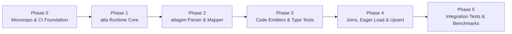

# Implementation Roadmap

This document outlines the phased implementation plan, milestones, deliverables, and corresponding GitHub tracking issues for `atla` and `atlagen`.

---

## Milestone Overview

---

## GitHub Tracking Issues

| Issue | Phase | Title |
| :--- | :--- | :--- |
| [#1](https://github.com/hirokazumiyaji/atla/issues/1) | Phase 0 | Monorepo setup (`uv` workspace), developer toolchain, and CI pipeline |
| [#2](https://github.com/hirokazumiyaji/atla/issues/2) | Phase 1 | `atla`: Implement Expression Tree AST (`Expr[T]`, `Column[T]`, operators, and aggregate helpers) |
| [#3](https://github.com/hirokazumiyaji/atla/issues/3) | Phase 1 | `atla`: Implement Dialect abstraction and single-pass `SQLCompiler` |
| [#4](https://github.com/hirokazumiyaji/atla/issues/4) | Phase 1 | `atla`: Implement `DBAdapter` protocol, transaction management, and driver adapters (`asyncpg` / `asyncmy` / `aiosqlite`) |
| [#5](https://github.com/hirokazumiyaji/atla/issues/5) | Phase 1 | `atla`: Implement immutable `BaseQuery` and `Mutation` runtime classes |
| [#6](https://github.com/hirokazumiyaji/atla/issues/6) | Phase 2 | `atlagen`: Implement Atlas JSON schema parser and normalized Internal Representation (`SchemaIR`) |
| [#7](https://github.com/hirokazumiyaji/atla/issues/7) | Phase 2 | `atlagen`: Implement multi-dialect SQL-to-Python Type Mapper and row codec resolver |
| [#8](https://github.com/hirokazumiyaji/atla/issues/8) | Phase 2 | `atlagen`: Implement CLI interface (`generate` / `check`) and configuration loader |
| [#9](https://github.com/hirokazumiyaji/atla/issues/9) | Phase 3 | `atlagen`: Implement code emitters (`enums.py`, `models.py`, `query.py`, `client.py`) |
| [#10](https://github.com/hirokazumiyaji/atla/issues/10) | Phase 3 | Build end-to-end static type verification suite (`pyright --strict` & `mypy --strict`) |
| [#11](https://github.com/hirokazumiyaji/atla/issues/11) | Phase 4 | Implement type-safe Joins (`inner` / `left join` / self-join aliasing) and Batch Eager Loading |
| [#12](https://github.com/hirokazumiyaji/atla/issues/12) | Phase 4 & 5 | Implement Bulk Insert, Upsert, Partial Projections, and multi-RDBMS integration & benchmark suites |

---

## Phase 0: Project Scaffolding & Monorepo Setup

Establish the `uv` workspace monorepo and strict quality gates to develop and test `atla` (zero-dependency runtime) and `atlagen` (AOT code generator CLI) side-by-side.

### Tasks:
- **[#1](https://github.com/hirokazumiyaji/atla/issues/1) Monorepo Structure & Developer Toolchain**
  - Create root `pyproject.toml` along with `packages/atla/pyproject.toml` (`dependencies = []`) and `packages/atlagen/pyproject.toml`
  - Configure `ruff` (lint/format), `pyright --strict`, `mypy --strict`, `pytest`, and `pytest-asyncio`
  - Set up GitHub Actions CI workflow for linting, strict type checking, and unit tests

---

## Phase 1: `atla` Runtime Core Foundation

Implement the zero-dependency, `__slots__`-based runtime core.

### Tasks:
- **[#2](https://github.com/hirokazumiyaji/atla/issues/2) Expression Tree AST (`atla/expressions.py`)**
  - Implement `Expr[T_co]`, `Column[T]`, `Literal[T]`, `BinaryOp[T]`, `UnaryOp[T]`, `LogicalOp`, `InOp[T]`, `BetweenOp[T]`, `FuncCall[T]`, `RawSQL[T]`, and `OrderByClause`
  - Implement `Expr.__bool__` guard to prevent accidental Python `and`/`or` usage, and safe empty `IN ()` fallback (`1 = 0` / `1 = 1`)
  - Implement logical combinators (`and_`, `or_`, `not_`) and aggregate functions (`count`, `sum_`, `avg`, `min_`, `max_`)
- **[#3](https://github.com/hirokazumiyaji/atla/issues/3) Dialects & Single-Pass SQL Compiler (`atla/dialect.py`, `atla/compiler.py`)**
  - Implement `PostgresDialect`, `CockroachDialect`, `MySQLDialect`, `TiDBDialect`, and `SQLiteDialect`
  - Handle identifier quoting, positional placeholders (`$n`, `%s`, `?`), and dialect-aware `ILIKE` expansion
  - Implement `SQLCompiler` for single-pass AST traversal without intermediate string concatenation
- **[#4](https://github.com/hirokazumiyaji/atla/issues/4) `DBAdapter` Protocol & Driver Adapters (`atla/adapter/`)**
  - Define `DBAdapter` protocol (`fetch_all`, `fetch_one`, `fetch_val`, `execute`, `execute_many`, `transaction`)
  - Implement `AsyncpgAdapter` (PostgreSQL / CockroachDB), `AsyncmyAdapter` (MySQL / TiDB), and `AiosqliteAdapter` (SQLite)
  - Support connection-pinned async transactions and nested `SAVEPOINT` transactions
- **[#5](https://github.com/hirokazumiyaji/atla/issues/5) Immutable `BaseQuery` & `Mutation` Classes (`atla/query.py`, `atla/errors.py`)**
  - Implement `BaseSelectQuery[RecordT]` (`where`, `order_by`, `limit`, `offset`, `all`, `first`, `one`, `count`, `exists`, `to_sql`)
  - Implement `BaseInsertQuery[RecordT]`, `BaseUpdateQuery[RecordT]`, and `BaseDeleteQuery`
  - Implement `UnsafeMutationError` (protecting against accidental full-table `UPDATE`/`DELETE`), `NotFoundError`, and `MultipleResultsError`

---

## Phase 2: `atlagen` CLI & Schema Parsing

Parse the JSON schema emitted by `atlas schema inspect` into a normalized Internal Representation (`SchemaIR`) and resolve dialect-specific Python types.

### Tasks:
- **[#6](https://github.com/hirokazumiyaji/atla/issues/6) Atlas JSON Schema Parser & `SchemaIR` (`atlagen/ir.py`, `atlagen/parser.py`)**
  - Deserialize and validate Atlas `schema inspect` JSON structures (`schemas`, `tables`, `columns`, `primary_key`, `foreign_keys`, `indexes`, `enums`)
  - Normalize table and column names into valid Python identifiers (PascalCase singular model names, snake_case attributes, keyword collision escaping)
  - Detect `default` expressions, `auto_increment`, `serial`, and `identity` attributes to classify required vs. optional insert columns
- **[#7](https://github.com/hirokazumiyaji/atla/issues/7) Multi-Dialect SQL-to-Python Type Mapper & Row Codec Resolver (`atlagen/mapper.py`)**
  - Map all standard SQL types across PostgreSQL, CockroachDB, MySQL, TiDB, and SQLite (including length/precision modifiers, unsigned integers, arrays, Enums, UUID, and JSON/JSONB)
  - Wrap nullable columns in `T | None` and collect required standard library imports
  - Generate static inline row decoding expressions (`row_codec`) for dialects/columns requiring conversion from raw tuple values
- **[#8](https://github.com/hirokazumiyaji/atla/issues/8) `atlagen` CLI Interface & Configuration Loader (`atlagen/cli.py`, `atlagen/config.py`, `atlagen/inspect.py`)**
  - Implement `atlagen generate` and CI-oriented `atlagen check` subcommands
  - Support stdin piping (`-`), local JSON files, and automatic `atlas schema inspect` subprocess execution
  - Support reading configuration from `[tool.atlagen]` in `pyproject.toml` via standard library `tomllib`

---

## Phase 3: Code Emission & Static Type Verification

Emit deterministic Python modules (`enums.py`, `models.py`, `query.py`, `client.py`, `__init__.py`) from `SchemaIR` and verify them under strict static type checking.

### Tasks:
- **[#9](https://github.com/hirokazumiyaji/atla/issues/9) Code Emitters (`atlagen/emitter/`)**
  - `enums.py`: Emit `StrEnum` classes
  - `models.py`: Emit `@dataclass(slots=True, frozen=True)` records, static `_from_row` hydrators, and alias-capable `{Table}Table` descriptors
  - `query.py`: Emit `{Table}Query` with pre-computed `_SELECT_SQL` constants, `{Table}Repository.insert()` distinguishing required vs. optional columns, and `{Table}UpdateBuilder.set()` accepting both literals and `Expr[T]`
  - `client.py` & `__init__.py`: Emit `AtlaClient` with table repositories and `transaction()` context manager
- **[#10](https://github.com/hirokazumiyaji/atla/issues/10) Static Type Verification Test Suite (`tests/typecheck/`)**
  - Automated `pyright --strict` and `mypy --strict` tests over generated code for PostgreSQL, MySQL, and SQLite schemas
  - Negative type tests verifying that invalid type comparisons, missing required `insert()` arguments, and invalid column references fail type checking

---

## Phase 4 & 5: Relations, Advanced Mutations, Integration Tests & Benchmarks

Implement type-safe joins, N+1-free batch eager loading, bulk inserts, and upserts, backed by multi-RDBMS integration tests and performance benchmarks.

### Tasks:
- **[#11](https://github.com/hirokazumiyaji/atla/issues/11) Type-Safe Joins (`join` / `left_join`), Self-Join Aliasing, and Batch Eager Loading**
  - Tuple-slicing row hydration where `db.user.query().join(Post, ...)` returns `list[tuple[UserRecord, PostRecord]]` and `left_join` returns `list[tuple[UserRecord, PostRecord | None]]`
  - 2-query batch eager loading (`WHERE fk IN (...)`) using foreign key metadata to eliminate N+1 queries without lazy-loading proxies
- **[#12](https://github.com/hirokazumiyaji/atla/issues/12) Bulk Insert, Upsert, Partial Projections, Integration Tests & Benchmarks**
  - `insert_many()`, dialect-specific Upsert builders (`ON CONFLICT` / `ON DUPLICATE KEY UPDATE`), and `TypeVarTuple`-based partial column selection (`select(User.id, User.email) -> list[tuple[int, str]]`)
  - End-to-end integration tests (`aiosqlite`, `asyncpg`, `asyncmy`) and benchmark suite (`tests/benchmarks/`) comparing against raw drivers and SQLAlchemy 2.0
